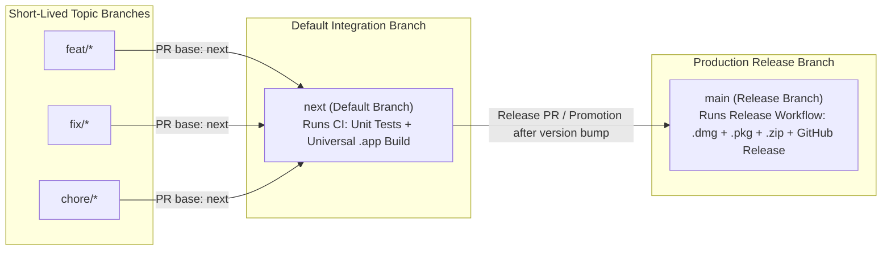

# CI/CD, Two-Branch (`next` → `main`) Topology, and Automated macOS Release Engineering

> **Scope & Primary Sources:** This document defines the continuous integration, branching topology, and automated release pipeline for a native macOS + JavaScript application (`Minimal Pomodoro`) on GitHub Actions. All technical claims, workflow syntax, runner specifications, and security practices are verified against primary sources: [GitHub Docs: About the default branch](https://docs.github.com/en/pull-requests/collaborating-with-pull-requests/proposing-changes-to-your-work-with-pull-requests/about-branches#about-the-default-branch), [GitHub Docs: Workflow syntax for GitHub Actions](https://docs.github.com/en/actions/writing-workflows/workflow-syntax-for-github-actions), [GitHub Docs: Automatic token authentication (`GITHUB_TOKEN`)](https://docs.github.com/en/actions/security-for-github-actions/security-guides/automatic-token-authentication), [GitHub Docs: Security hardening for GitHub Actions](https://docs.github.com/en/actions/security-for-github-actions/security-guides/security-hardening-for-github-actions), [GitHub Actions Runner Images (`macos-15`)](https://github.com/actions/runner-images/blob/main/images/macos/macos-15-arm64-Readme.md), [GitHub CLI (`gh release create` / `gh release view`)](https://cli.github.com/manual/gh_release_create), and [Semantic Versioning 2.0.0](https://semver.org/).

---

## 1. Branching Topology (`next` Default Integration Branch → `main` Production Release Branch)

### 1.1 Why `next` Is the Default Branch and `main` Is the Production Release Branch

In GitHub repositories, the **default branch** governs three platform-wide behaviors ([GitHub Docs: About the default branch](https://docs.github.com/en/pull-requests/collaborating-with-pull-requests/proposing-changes-to-your-work-with-pull-requests/about-branches#about-the-default-branch)):
1. It is the branch checked out automatically when anyone runs `git clone`.
2. It is the **automatic base branch** pre-selected whenever a contributor or automation opens a pull request via the GitHub web UI or `gh pr create` without `--base`.
3. It is the branch against which default code search and status badges resolve.

By configuring **`next` as the repository's default branch** and reserving **`main` strictly for production releases**, the repository achieves clean separation between continuous integration and customer-facing releases:



| Branch | Role | Default PR Target? | Triggered GitHub Actions Workflows |
| :--- | :--- | :--- | :--- |
| **`feat/*`, `fix/*`, `chore/*`** | Short-lived topic branches branched off `next`. | No (head branch of PRs). | `.github/workflows/ci.yml` (via `pull_request` targeting `next`). |
| **`next` (Default Branch)** | Pre-release integration branch where all day-to-day features, bug fixes, and refactors land first. | **Yes** — `gh pr create` and GitHub UI target `next` automatically. | `.github/workflows/ci.yml` (on `push` and `pull_request`). |
| **`main` (Release Branch)** | Production release branch; every version-bumped promotion from `next` to `main` corresponds to a shipping release (`vX.Y.Z`). | Only for release-promotion PRs (`gh pr create --base main --head next`). | `.github/workflows/ci.yml` **and** `.github/workflows/release.yml` (publishes `.dmg`, `.pkg`, `.zip`, and `SHA256SUMS.txt` to GitHub Releases). |

### 1.2 Recommended Branch Rulesets (`next` and `main`)

Per [GitHub Docs: About rulesets](https://docs.github.com/en/repositories/configuring-branches-and-merges-in-your-repository/managing-rulesets/about-rulesets), both `next` and `main` should enforce:
- **Block force pushes** and **restrict deletions** so release history and integration history cannot be rewritten.
- **Require status checks to pass before merging** (specifically the `Verify Tests & macOS Universal Bundle` job from `ci.yml`).

---

## 2. Continuous Integration Workflow (`.github/workflows/ci.yml`)

Every push and pull request targeting `next` or `main` must prove both **JavaScript/logic correctness** and **native macOS Universal Binary compilation** on a clean Apple Silicon macOS runner (`macos-15`) ([GitHub Docs: Workflow syntax for GitHub Actions](https://docs.github.com/en/actions/writing-workflows/workflow-syntax-for-github-actions); [`macos-15` Runner Image](https://github.com/actions/runner-images/blob/main/images/macos/macos-15-arm64-Readme.md)):

### 2.1 Core Design Elements of `ci.yml`

1. **Triggers (`on.push` & `on.pull_request`):** Fires on `push` to `next` and `main` and on `pull_request` targeting `next` and `main` ([GitHub Docs: `on.push` / `on.pull_request`](https://docs.github.com/en/actions/writing-workflows/workflow-syntax-for-github-actions#onpushpull_requestpull_request_targetbranchesbranches-ignore)).
2. **Concurrency Deduplication (`concurrency`):**
   ```yaml
   concurrency:
     group: ${{ github.workflow }}-${{ github.head_ref || github.ref }}
     cancel-in-progress: true
   ```
   Using `github.head_ref || github.ref` groups rapid commits pushed to the same PR branch and cancels superseded runs immediately (`cancel-in-progress: true`), conserving macOS runner minutes ([GitHub Docs: Using concurrency](https://docs.github.com/en/actions/writing-workflows/choosing-when-your-workflow-runs/control-the-concurrency-of-workflows-and-jobs)).
3. **Least-Privilege Token Scope (`permissions: contents: read`):** Setting `permissions: contents: read` at the top level restricts `GITHUB_TOKEN` to read-only repository checkout and automatically sets all unspecified permission scopes to `none` ([GitHub Docs: `permissions`](https://docs.github.com/en/actions/writing-workflows/workflow-syntax-for-github-actions#permissions)).
4. **Native macOS Runner (`runs-on: macos-15`):** Provisions a GitHub-hosted Apple Silicon (`arm64`) macOS 15 virtual machine with Xcode Command Line Tools (`swiftc`, `lipo`, `codesign`, `hdiutil`, `pkgbuild`, `productbuild`) pre-installed ([`macos-15-arm64` README](https://github.com/actions/runner-images/blob/main/images/macos/macos-15-arm64-Readme.md)).
5. **Two-Layer Verification Gate:**
   - **Layer 1 — Automated Test Suite (`npm test`):** Runs the Node.js unit and integration test suite (`node --test`).
   - **Layer 2 — Native macOS Universal Bundle Build & Verification:** Executes `./scripts/build-macos-app.sh`, asserts that both `x86_64` and `arm64` slices exist in `Contents/MacOS/MinimalPomodoro` via `lipo -archs`, and verifies the code signature via `codesign --verify --deep --strict`.

---

## 3. Automated Release Pipeline on `main` (`.github/workflows/release.yml`)

When tested changes on `next` are promoted to `main` with a bumped [Semantic Version (`MAJOR.MINOR.PATCH`)](https://semver.org/) in `package.json`, `.github/workflows/release.yml` automatically builds, verifies, packages, and publishes the downloadable macOS installers to GitHub Releases.

### 3.1 Key Architecture of `release.yml`

1. **Single-Source-of-Truth Version Extraction:**
   Extracts `version` directly from `package.json` (`node -p "require('./package.json').version"`) and sets `TAG="v${VERSION}"`. Both `scripts/build-macos-app.sh` and `scripts/package-macos-release.sh` read this same `package.json` version so `CFBundleShortVersionString`, `.pkg` package version, and release asset filenames (`Minimal-Pomodoro-<version>-universal.{dmg,pkg,zip}`) never drift.
2. **Idempotency Guard (`gh release view`):**
   Checks whether a GitHub Release for `v<version>` already exists (`gh release view "$TAG"`).
   - If the release **already exists** (for example, a documentation-only hotfix merged to `main` without bumping `package.json`), the job logs a clean message and exits `0` without failing or overwriting immutable release assets.
   - If the release **does not exist**, the pipeline proceeds to build and publish `v<version>`.
3. **Full Test & Packaging Gate Before Publishing:**
   Re-runs `npm test` and `./scripts/package-macos-release.sh` on `macos-15`, generating:
   - `dist/Minimal-Pomodoro-<version>-universal.dmg` (compressed `UDZO` drag-to-Applications disk image)
   - `dist/Minimal-Pomodoro-<version>-universal.pkg` (native macOS Installer wizard targeting `/Applications`)
   - `dist/Minimal-Pomodoro-<version>-universal.zip` (`ditto` PKZip archive preserving resource forks)
   - `dist/SHA256SUMS.txt` (`shasum -a 256` checksum manifest)
4. **Automated GitHub Release Creation (`gh release create`):**
   Uses the built-in `GITHUB_TOKEN` with `permissions: contents: write` ([GitHub Docs: Automatic token authentication](https://docs.github.com/en/actions/security-for-github-actions/security-guides/automatic-token-authentication)) to create the annotated tag and release with `--generate-notes` and custom asset labels (`<path>#<label>`) ([GitHub CLI: `gh release create`](https://cli.github.com/manual/gh_release_create)).
5. **Non-Canceling Concurrency (`cancel-in-progress: false`):**
   Unlike `ci.yml`, `release.yml` sets `cancel-in-progress: false` inside its `release-main` concurrency group so an in-flight release upload is never aborted mid-publish.

---

## 4. Security & Supply-Chain Best Practices for GitHub Actions

Following [GitHub Docs: Security hardening for GitHub Actions](https://docs.github.com/en/actions/security-for-github-actions/security-guides/security-hardening-for-github-actions):

1. **Least-Privilege `GITHUB_TOKEN` Permissions:**
   - `ci.yml` declares `permissions: contents: read` globally.
   - `release.yml` declares `permissions: contents: write` solely so `gh release create` can push the release tag and upload binary assets.
2. **Preventing Script Injection in `run:` Blocks:**
   - Never interpolate untrusted GitHub event context (such as `${{ github.event.pull_request.title }}` or `${{ github.head_ref }}`) directly inside a shell `run:` string, where shell metacharacters could execute arbitrary commands ([GitHub Docs: Mitigating script injections](https://docs.github.com/en/actions/security-for-github-actions/security-guides/security-hardening-for-github-actions#understanding-the-risk-of-script-injections)).
   - Pass dynamic values through intermediate `env:` variables or `$GITHUB_OUTPUT` and double-quote all shell expansions (`"$TAG"`, `"$VERSION"`).
3. **Deterministic Dependency Installation & Checksums:**
   - Every release publishes `SHA256SUMS.txt` (`shasum -a 256`) alongside the `.dmg`, `.pkg`, and `.zip` installers so users and downstream package managers (such as Homebrew Cask) can verify binary integrity via `shasum -a 256 -c SHA256SUMS.txt`.

---

## 5. Contributor & Maintainer Release Runbook

### 5.1 Daily Feature & Bugfix Workflow (Targeting `next`)

Because `next` is the repository's default branch, all daily development branches off `next` and merges back into `next`:

```bash
# 1. Start from an up-to-date next branch
git checkout next
git pull origin next

# 2. Create a topic branch
git checkout -b feat/my-improvement

# 3. Run the test suite and native macOS build locally
npm test
npm run build:macos

# 4. Commit, push, and open a PR (automatically targets `next`)
git push -u origin feat/my-improvement
gh pr create --fill
```

### 5.2 Promoting a Tested Release (`next` → `main`)

When `next` is green and ready to ship a new release to end users:

```bash
# 1. On `next`, bump the Semantic Version in package.json (e.g., 1.0.0 -> 1.1.0)
git checkout next
git pull origin next
npm version minor --no-git-tag-version

# 2. Verify tests and packaging locally, then commit and push to `next`
npm test
git add package.json
git commit -m "chore(release): bump version to v$(node -p "require('./package.json').version")"
git push origin next

# 3. Promote `next` into `main` via a Release PR (or fast-forward merge)
gh pr create \
  --base main \
  --head next \
  --title "chore(release): v$(node -p "require('./package.json').version")" \
  --body "Promotes verified \`next\` branch to \`main\` and triggers automated macOS release packaging."
```

As soon as the promotion lands on `main`, `.github/workflows/release.yml` automatically compiles the Universal (`arm64` + `x86_64`) `.app` bundle, builds the `.dmg`, `.pkg`, and `.zip` installers plus `SHA256SUMS.txt`, and publishes them to the repository's **GitHub Releases** page (`releases/latest`).

---

## 6. Fact Verification Ledger

Every claim in this document was verified directly against primary documentation:

| # | Claim | Verified Fact / Verbatim Evidence | Primary Source & Location |
| :--- | :--- | :--- | :--- |
| 1 | Default branch governs `git clone` checkout and default PR base branch | The default branch is the initial branch checked out locally on `git clone` and the automatic base branch targeted by new pull requests unless another base is specified. | [GitHub Docs: About the default branch](https://docs.github.com/en/pull-requests/collaborating-with-pull-requests/proposing-changes-to-your-work-with-pull-requests/about-branches#about-the-default-branch) |
| 2 | Explicit `permissions` block sets unspecified `GITHUB_TOKEN` scopes to `none` | When any permission key is specified in `permissions`, all unspecified permissions are automatically set to `none` (least privilege). `contents: read` allows checkout; `contents: write` allows creating releases and tags. | [GitHub Docs: `permissions` workflow syntax](https://docs.github.com/en/actions/writing-workflows/workflow-syntax-for-github-actions#permissions); [Automatic token authentication](https://docs.github.com/en/actions/security-for-github-actions/security-guides/automatic-token-authentication) |
| 3 | `concurrency` with `cancel-in-progress` cancels superseded runs | Setting `concurrency.group` with `cancel-in-progress: true` cancels any currently running job or workflow in the same group when a newer run is queued; `cancel-in-progress: false` queues without canceling. | [GitHub Docs: Control the concurrency of workflows and jobs](https://docs.github.com/en/actions/writing-workflows/choosing-when-your-workflow-runs/control-the-concurrency-of-workflows-and-jobs) |
| 4 | `macos-15` GitHub-hosted runner provides Apple Silicon (`arm64`) & Xcode toolchain | The `macos-15` runner label targets an Apple Silicon (`arm64`) macOS 15 virtual machine with Xcode, `swiftc`, `lipo`, `codesign`, `hdiutil`, `pkgbuild`, `productbuild`, Node.js, and `gh` CLI pre-installed. | [GitHub Actions `runner-images`: `macos-15-arm64` README](https://github.com/actions/runner-images/blob/main/images/macos/macos-15-arm64-Readme.md) |
| 5 | Mitigating script injection in GitHub Actions `run:` steps | Directly interpolating `${{ ... }}` expressions inside `run:` scripts risks shell command injection; passing values via intermediate `env:` variables prevents the shell from parsing untrusted input as code. | [GitHub Docs: Security hardening for GitHub Actions — Script injections](https://docs.github.com/en/actions/security-for-github-actions/security-guides/security-hardening-for-github-actions#understanding-the-risk-of-script-injections) |
| 6 | Publishing release assets with display labels via `gh release create` | `gh release create <tag> <file>#<label> --generate-notes` creates a GitHub Release, generates release notes via the GitHub API, and attaches binary assets with custom display labels using `GITHUB_TOKEN`. | [GitHub CLI Manual: `gh release create`](https://cli.github.com/manual/gh_release_create) |
| 7 | Semantic Versioning (`MAJOR.MINOR.PATCH`) format | Versions follow `MAJOR.MINOR.PATCH` where `MAJOR` increments for incompatible changes, `MINOR` for backward-compatible functionality, and `PATCH` for backward-compatible bug fixes. | [Semantic Versioning 2.0.0 (`semver.org`)](https://semver.org/) |
